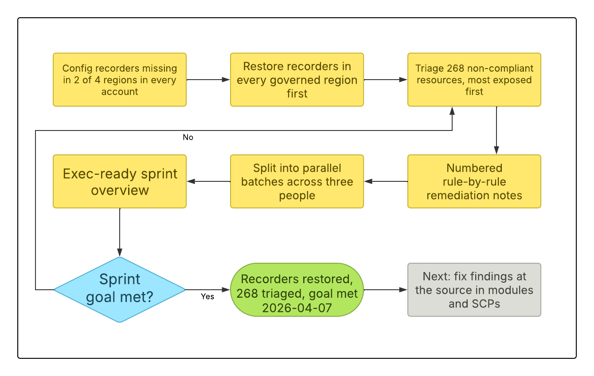

# Org-wide governance and findings

I restored missing AWS Config recorders organization-wide, triaged 268 non-compliant resources and led parallel remediation.

## Problem

Config recorders were missing in 2 of 4 governed regions in every account, and stopped in all 4 in the management account. Without recorders there was no compliance evidence and no detection of drift.

## Layer

Foundation, with observability. Concerns: security and compliance.

## Decisions

| Decision | Why |
|---|---|
| Restore recorders in every governed region first | You cannot fix what you cannot see. |
| Triage the 268 non-compliant resources by risk | The most exposed come first, such as network exposure and default security groups. |
| Write numbered, rule-by-rule remediation notes | Work could be split between three people in parallel batches. |
| Produce an executive-ready sprint overview | Leadership could see progress and trade-offs. |

## Result

- Recorders restored in all governed regions.
- 268 non-compliant resources triaged.
- The Config sprint goal was met on 2026-04-07.

## Next step

Fix recurring findings at the source, in Terraform modules and SCP guardrails, so the same finding does not come back.

---

This case study is generalized. It has no client or employer identifiers.
