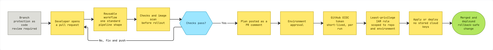

# Keyless, standard pipelines

I turned dozens of hand-rolled deployments into reusable, keyless pipelines used across 176 repositories.

## Problem

Every repository had its own hand-rolled or manual deployment. Workflow files were duplicated, there were no common security checks, and many pipelines depended on stored credentials.

## Layer

Delivery. Concerns: security and reliability.

## Decisions

| Decision | Why |
|---|---|
| Build central reusable GitHub Actions workflows (Lambda, frontend, OIDC) | Fix once and every repository benefits. |
| Use OIDC for deployments | There are no long-lived keys to leak or rotate. |
| Write the standard: GitHub Actions only, no local apply, no access keys, LocalStack for local tests | It makes the secure path the default. |
| Roll out across 127 tickets and 176 repositories, including runtime upgrades for 25 critical Lambda functions | Old runtimes should not become vulnerabilities. |

## Result

- One secure way to deploy that every developer team uses.
- Deployments without stored credentials.
- 170 auto-update pull requests across 158 repositories, with SonarQube, Dependabot and branch protection added.

## Next step

Policy checks that block non-standard pipelines, and a dashboard for adoption and failures.

---

This case study is generalized. It has no client or employer identifiers.
