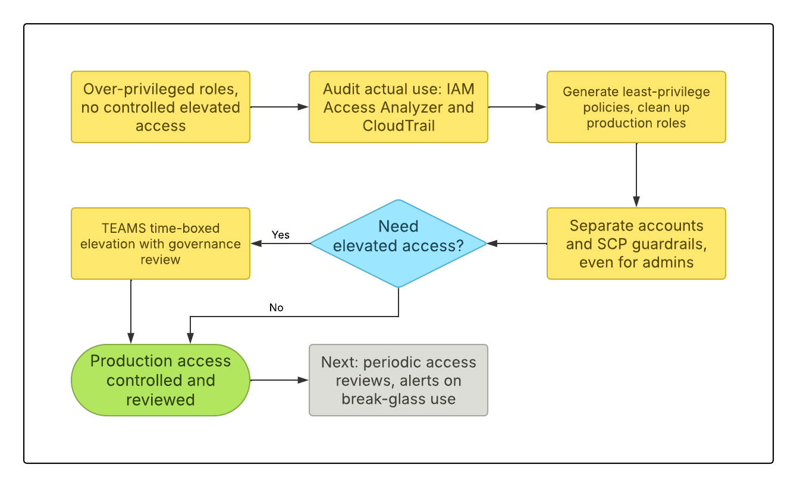

# From standing access to least privilege

I replaced broad, standing access with least-privilege roles and time-boxed, reviewed elevation, backed by separate accounts and guardrails.

## Problem

Roles were over-privileged and there was no controlled way to get elevated access. A mistake or a compromise could have a very large blast radius.

## Layer

Foundation (identity). Concern: security.

## Decisions

| Decision | Why |
|---|---|
| Audit with IAM Access Analyzer and CloudTrail activity | Permissions should follow what is actually used, not guesses. |
| Generate least-privilege policies and clean up production roles | It removes standing excess access. |
| Set up TEAMS for time-boxed elevated access, with governance review of production | People get access when they need it, with an approval trail. |
| Split environments into separate accounts and apply SCPs | It limits the blast radius and enforces guardrails even for admins. |

## Result

- Production access is controlled and reviewed.
- Roles are least-privilege by default, and elevation is short-lived.

## Next step

Automate periodic access reviews and alert on the use of break-glass or elevated roles.

---

This case study is generalized. It has no client or employer identifiers.
