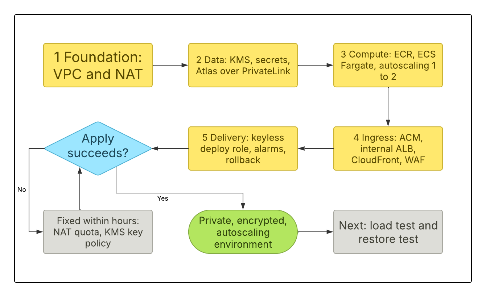

# A private dev environment, layer by layer

I built a private, encrypted, autoscaling container environment behind CloudFront and a WAF, with alarm-based rollback, layer by layer in Terraform.

## Problem

Developers needed a private, authenticated dev environment that mirrored a design we already trusted, and none existed. Without it they could not test realistically, and one built carelessly could expose data.

## Layer

All five layers, in build order: foundation, data, compute, ingress, delivery.

## Decisions

| Decision | Why |
|---|---|
| Internal ALB behind CloudFront with a VPC origin and a WAF | The origin is never public, and the edge filters traffic. |
| KMS-encrypted resources, with secrets referenced by the tasks | There are no plain-text secrets and key access is controlled. |
| MongoDB Atlas over PrivateLink | Database traffic never crosses the public internet. |
| Autoscale 1 to 2 tasks, with 5xx and unhealthy-host alarms and alarm-based rollback | A small footprint for cost, with detection and automatic recovery. |
| A keyless, least-privilege deploy role for the app pipeline | Deployments need no stored credentials. |

## Result

- A complete environment, with most phases built in one week.
- Two apply failures, a NAT quota and a KMS key policy, were found and fixed within hours.

## Next step

Add a load test and a restore test, and move the same pattern to higher environments with stricter approvals.

---

This case study is generalized. It has no client or employer identifiers.
