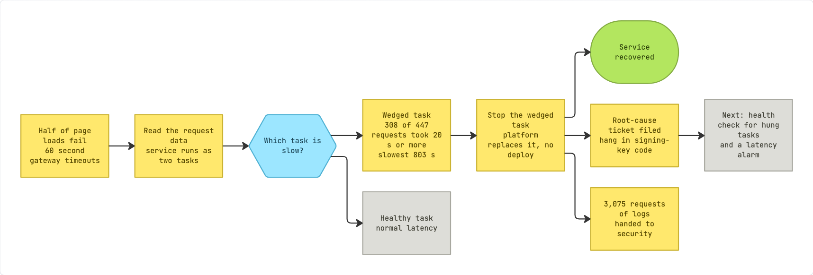

# The production API that hung

About half of production page loads failed with 60-second gateway timeouts. I found the one wedged task from request data and restored service without a deploy.

## Problem

Users could not load pages reliably. The API ran as two tasks behind a load balancer, and requests were timing out at the gateway.

## Layer

Compute, with observability. Concerns: reliability and observability.

## Decisions

| Decision | Why |
|---|---|
| Read the request data per task instead of guessing | It showed one of the two tasks was wedged and the other was healthy. |
| Replace the wedged task instead of redeploying | It restored service quickly with no code change. |
| File a root-cause follow-up for the hang in the signing-key code | The task needed a real fix, not only a restart. |
| Extract the request logs for the security team | They needed the evidence for review. |

## Result

- On the wedged task, 308 of 447 requests took 20 seconds or more. The slowest took 803 seconds.
- 3,075 requests were extracted for review.
- Service recovered once the task was replaced.

## Next step

A health check that detects hung tasks, not only crashed ones, so the platform replaces them automatically, plus a latency alarm so we hear about it before users do.

---

This case study is generalized. It has no client or employer identifiers.
