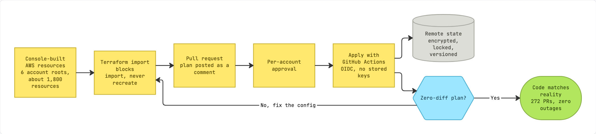

# Console-built AWS under Terraform

I brought a console-built AWS estate under Terraform without recreating anything, behind a reviewed pipeline with no stored cloud keys.

## Problem

Infrastructure had been built by hand in the console. There was no single source of truth and no review before anything changed. Nobody could repeat or audit a change, and every infrastructure request was a one-off.

## Layer

Foundation, with delivery (the pipeline). Concerns: reliability, security and change control.

## Decisions

| Decision | Why |
|---|---|
| Import live resources with import blocks, never rebuild | Rebuilding would cause outages and risk data loss. |
| Require a zero-diff plan after every import | It proves the code matches reality before anyone depends on it. |
| Post the plan as a PR comment, approve per account, apply through GitHub Actions OIDC | Review comes before change, there are no stored cloud keys, and the history is traceable. |
| Write an import plan, an interim IaC policy and a README per account | Other teams could follow the process without me. |

## Result

- About 1,800 resource blocks across 6 account roots in about 4 weeks.
- 272 Terraform pull requests and about 1,059 import blocks, with zero outages.
- Legacy Lambda functions decommissioned along the way.

## Next step

Scheduled drift detection, and shared modules for the patterns that repeat.

---

This case study is generalized. It has no client or employer identifiers.
